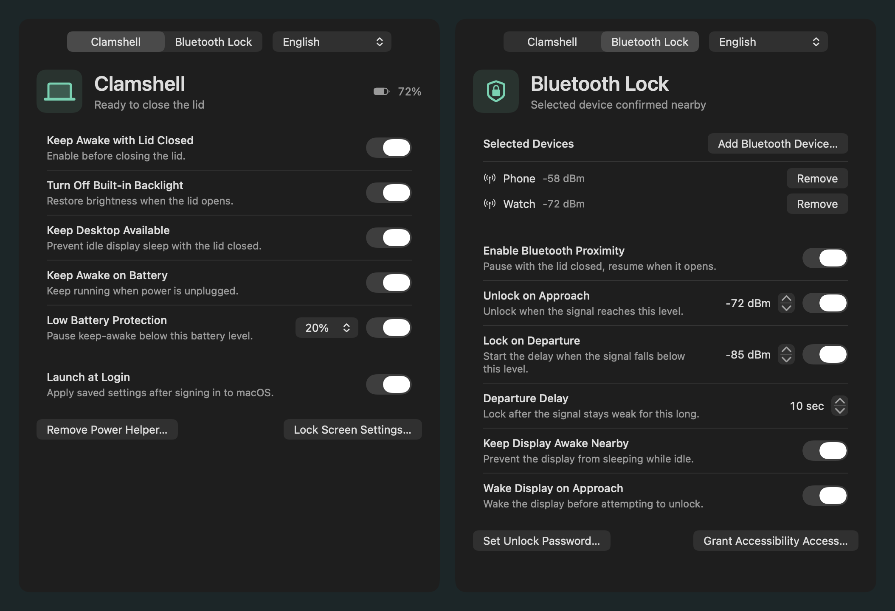

# FoldDay · 折昼

**Keep your MacBook awake with the lid closed and the built-in backlight off.**

FoldDay is a native macOS menu bar app for unattended tasks and computer-use agents. When the lid is open, selected Bluetooth devices can lock your Mac as you leave and unlock your session when you return.

[Install](#install) · [Quick start](#quick-start) · [简体中文](README.zh-CN.md)



The preview shows sample devices and signal readings.

## What FoldDay does

- **Closed-lid keep-awake.** Keep macOS running on battery with the built-in backlight at zero. Reopening the lid restores its prior brightness. FoldDay is designed for use without an external display.
- **Bluetooth proximity lock and unlock.** Add BLE devices in FoldDay, see each device’s RSSI, and tune thresholds and departure delay. Closed-lid mode pauses proximity actions.
- **Battery protection and launch at login.** Pause keep-awake below a configurable battery level, set to 20% by default. Turning keep-awake off or quitting restores the normal sleep policy.

## Install

Requires **macOS 14 or later**. The release includes Apple silicon and Intel builds in one app.

```sh
brew install --cask hoemr/tap/foldday
```

You can also get `FoldDay.app.zip` from [GitHub Releases](https://github.com/Hoemr/FoldDay/releases/latest) and move the app to **Applications**. The release is code-signed and has no Apple notarization. macOS may ask you to approve the app on first launch. [Apple’s first-launch guidance](https://support.apple.com/en-us/102445)

<details>
<summary>Build from source</summary>

Install Apple Command Line Tools, then run:

```sh
git clone https://github.com/Hoemr/FoldDay.git
cd FoldDay
zsh build.sh "$PWD/dist/FoldDay.app"
```

Move `dist/FoldDay.app` to **Applications**.

</details>

Open FoldDay and choose **FoldDay Settings…** from its menu bar icon. The **Language** menu in Settings lets you choose **System Default**, **English**, or **简体中文**.

## Quick start

### Keep your Mac awake with the lid closed

1. Open **Clamshell** and click **Authorize Power Helper…** to complete the one-time administrator setup.
2. Turn on **Keep Awake with Lid Closed** and choose your backlight and battery options. Wait for **Ready to close the lid** before closing it.
3. When using a computer-use agent, verify that it can still take a screenshot and click while the lid is closed.

### Lock when you leave and unlock when you return

1. Open **Bluetooth Lock** and use **Add Bluetooth Device…** to select a nearby BLE device.
2. For auto-unlock, use **Set Unlock Password…** and grant Accessibility access. FoldDay stores the password in your local Keychain.
3. Enable proximity sensing, confirm that the device is detected, then test leaving and returning. Each device displays its own signal strength.

## Compatibility

FoldDay uses macOS power settings for clamshell keep-awake and the private `DisplayServices` interface for brightness. Closed-lid GUI availability depends on your MacBook, macOS version, and screen-lock policy. Test your setup on battery and without an external display before relying on it.

<details>
<summary>Power helper, troubleshooting, and uninstall</summary>

The administrator setup installs a helper restricted to sleep control. If macOS already has a sleep override, **Take Over and Enable** hands responsibility for that override to FoldDay. On a later launch, FoldDay checks for a leftover override from an interrupted helper.

```sh
/Applications/FoldDay.app/Contents/MacOS/FoldDay --diagnostics
log show --last 15m --style compact --predicate 'subsystem == "local.lidawake"'
```

To uninstall, turn off **Launch at Login**, use **Remove Power Helper…** if the helper is installed, then quit. Run `brew uninstall --cask hoemr/tap/foldday` for a Homebrew install, or move the app to Trash. You can remove the saved password in Keychain Access by deleting the FoldDay entry with service name `local.lidawake.proximity`.

For repeat builds, set `FOLDDAY_SIGNING_IDENTITY` to the local signing certificate’s SHA-1 fingerprint and optionally set `FOLDDAY_SIGNING_KEYCHAIN`. Using the same signing identity preserves permissions associated with that identity.

</details>

## Credits

FoldDay’s Bluetooth proximity detection reuses MIT-licensed code from [BLEUnlock](https://github.com/Skyearn/BLEUnlock). [MIT notice](LICENSE-BLEUnlock)
