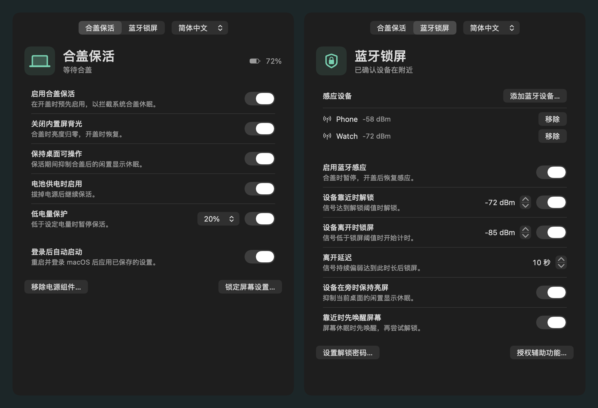

# 折昼 · FoldDay

**合上 MacBook，把内置屏背光调到零，桌面继续运行。**

折昼是一款 macOS 菜单栏工具，面向长时间任务和 Computer Use。开盖时，也可以用手机或其他蓝牙设备在离开时锁屏、返回时解锁。

[安装](#安装) · [快速上手](#快速上手) · [English](README.md)



图中设备和信号读数为示例。

## 能做什么

- **电池供电也能合盖保活。** 合盖后把内置屏背光设为零，开盖后恢复原亮度。适用于无外接显示器的场景。
- **手机靠近解锁，离开锁屏。** 在折昼里添加 BLE 设备，每台设备独立显示 RSSI。可调解锁和锁屏阈值、离开延迟，并可在设备附近时保持亮屏。合盖期间暂停蓝牙自动锁屏和解锁。
- **低电量保护和登录自启。** 默认低于 20% 暂停合盖保活，阈值可调。关闭保活或退出应用时恢复正常睡眠策略。

## 安装

需要 **macOS 14 或更新版本**。发布包同时支持 Apple 芯片与 Intel。

```sh
brew install --cask hoemr/tap/foldday
```

也可以从 [GitHub Releases](https://github.com/Hoemr/FoldDay/releases/latest) 下载 `FoldDay.app.zip`，将解压后的应用移到「应用程序」。发布包已签名，尚未获得 Apple 公证，macOS 可能要求在首次启动时确认。[Apple 首次启动说明](https://support.apple.com/zh-cn/102445)

<details>
<summary>从源码构建</summary>

安装 Apple Command Line Tools 后运行：

```sh
git clone https://github.com/Hoemr/FoldDay.git
cd FoldDay
zsh build.sh "$PWD/dist/FoldDay.app"
```

将 `dist/FoldDay.app` 移到「应用程序」。

</details>

启动后，从菜单栏打开「折昼 设置…」。「界面语言」可选跟随系统、English 或简体中文。

## 快速上手

### 合盖保活

1. 在「合盖保活」页点击「授权电源组件…」，完成一次管理员授权。
2. 开启「启用合盖保活」，按需选择背光和电池选项。看到「等待合盖」后再合盖。
3. 用 Computer Use 时，合盖后实测截图和点击，确认当前桌面仍可操作。

### 蓝牙锁屏

1. 在「蓝牙锁屏」页点击「添加蓝牙设备…」，从扫描列表选择设备。
2. 如需自动解锁，通过「设置解锁密码…」输入本机账户密码，并授予辅助功能权限。密码保存在本机钥匙串。
3. 开启蓝牙感应。确认设备被识别为在附近后，带设备离开再返回，测试锁屏和解锁。

## 兼容性

折昼通过 macOS 电源设置控制合盖保活，并通过私有 `DisplayServices` 接口控制背光。合盖后的 GUI 可用性取决于 MacBook 型号、macOS 版本和锁屏策略。长期使用前，建议拔掉电源和外接显示器实测。

<details>
<summary>电源组件、诊断和卸载</summary>

一次管理员授权会安装仅用于电源控制的组件。如果机器已有系统睡眠覆盖设置，可以通过「接管并启用」交给折昼管理。组件异常退出留下覆盖记录时，折昼会在下次启动时检查。

```sh
/Applications/FoldDay.app/Contents/MacOS/FoldDay --diagnostics
log show --last 15m --style compact --predicate 'subsystem == "local.lidawake"'
```

卸载时关闭「登录后自动启动」，如已授权电源组件则点击「移除电源组件…」，随后退出应用。通过 Homebrew 安装的版本可用 `brew uninstall --cask hoemr/tap/foldday` 卸载，也可以手动把应用移到废纸篓。如需删除已保存的解锁密码，在「钥匙串访问」中删除服务为 `local.lidawake.proximity` 的 FoldDay 条目。

重复构建时，可使用 `FOLDDAY_SIGNING_IDENTITY` 指定本机签名证书的 SHA-1 指纹，并用 `FOLDDAY_SIGNING_KEYCHAIN` 指定钥匙串。沿用签名身份可保留以该身份识别的授权。

</details>

## 致谢

蓝牙距离判定沿用 [BLEUnlock](https://github.com/Skyearn/BLEUnlock) 的 MIT 许可代码。[MIT 许可声明](LICENSE-BLEUnlock)
